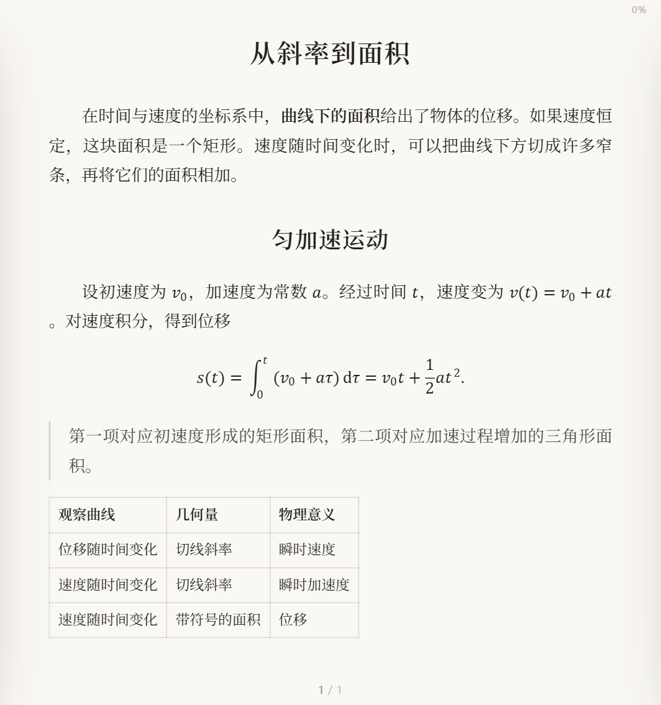

<h1 align="center">知白 · 书房</h1>
<p align="center">在手机、平板和电脑上读同一本书，也读带公式的 Markdown 笔记。</p>
<p align="center">
  <a href="https://tools.hogn.top/read/"><b>打开阅读器</b></a> ·
  <a href="#快速上手">快速上手</a> ·
  <a href="#markdown-与数学公式">Markdown 与数学公式</a> ·
  <a href="#本地运行">本地运行</a> ·
  <a href="#服务器部署">服务器部署</a>
</p>

<p align="center">
  <a href="docs/screenshots/markdown-reader.png"></a><br>
  <sub>同一份 Markdown 笔记中的正文、公式和表格，按当前屏幕宽度分页。</sub>
</p>

## 快速上手

1. 打开[知白书房](https://tools.hogn.top/read/)，选择「导入本地书籍」，或直接把文件拖到书架。试读本机文件无需书库钥匙。
2. 点封面开始阅读。轻点页面中央唤出菜单，点两侧或左右滑动翻页。在「排版」中调整字体、字号和行距，也可以切换为上下滚动。
3. 需要跨设备续读时，在各台设备上打开同一个云端书库，输入书库钥匙。将书籍存入云端后，进度、书签和划线笔记会随书同步。

**示例文件**　[PDF · 从图上读位移](examples/motion.pdf) · [Markdown · 微积分手记](examples/motion.md) · [TXT · 窗边三章](examples/window.txt)。下载任一文件即可导入书架。

## 阅读功能

| 想做什么 | 操作或支持的格式 |
| --- | --- |
| 阅读电子书和扫描件 | PDF 支持分段加载和缩放，有文字层的 PDF 可尝试重排。EPUB、MOBI、AZW3、FB2 可按屏宽重新分页，CBZ 用于漫画。 |
| 阅读自己的文档 | 支持 Markdown、HTML、Word（DOCX / DOC）和 TXT。TXT 可识别常见中文编码，并按章节标题生成目录。 |
| 调整排版 | 宋、楷、黑三种字体，素、宣、青、墨四种纸色。宽屏可双页并排；「方式」选「上下滑动」可单页连续阅读，PDF 在此模式下可用 Ctrl+滚轮、双指或右下角按钮放大。 |
| 查找和摘录 | 通过目录或全文搜索定位段落，添加书签，选中文字后划线或写笔记。笔记可导出为 Markdown。 |
| PDF 批注 | 在有文字层的 PDF 上选中文字即可划线、写笔记。打开 PDF 时自动载入文件自带的高亮和批注，可改色、改写或删除。在笔记页点「下载含笔记的 PDF」，所有改动会写成标准 PDF 批注，其他 PDF 阅读器也能看到。 |
| 管理书架 | 可导入文件或整个目录，按分类浏览，搜索书名。已解锁云端书库时可选择导入到本机或云端。 |

**桌面快捷键**　`←` / `→` 翻页，`T` 打开目录，`/` 搜索，`B` 加书签，`D` 切换日夜，`F` 全屏，`Esc` 返回。

## Markdown 与数学公式

导入 `.md` 或 `.markdown` 文件即可阅读。标题、强调、引用、嵌套列表、任务列表、表格和代码块由 Marked 解析。Temml 将 LaTeX 排成浏览器可显示的 MathML，渲染脚本和样式随应用提供。

行内公式使用 `$...$` 或 `\(...\)`。独立公式使用 `$$...$$` 或 `\[...\]`，将整组公式放在单独的行上。例如，把以下内容保存为 `运动笔记.md` 后导入：

```markdown
## 匀加速运动

初速度为 $v_0$，加速度为 \(a\)，经过时间 $t$ 后的位移为

\[
s(t) = \int_0^t (v_0 + a\tau)\,\mathrm{d}\tau
     = v_0 t + \frac{1}{2}at^2.
\]
```

行内代码和围栏代码块保留公式源码。遇到无法解析的 LaTeX 命令时，该处显示原文，其余公式仍会排版。

## 本地运行

使用 Node.js 24。前端是原生 ES 模块，后端使用 Node.js 标准库，克隆后即可启动。以下命令在 Bash 或 Git Bash 中执行。

```bash
git clone https://github.com/XYoung1201/ZhiBai.git
cd ZhiBai
mkdir -p books
BOOKS_DIR="$PWD/books" node server/dev.mjs
```

打开 [本地书房](http://127.0.0.1:8730/read/)。可直接导入文件试读。要启用本地云端书库，在终端查看首次启动生成的 `devdata/key.txt`，将钥匙输入书架。服务使用 `devdata/` 保存书目、封面和阅读状态。

如直接向 `books/` 复制书籍，可在同一项目目录重建书目，再刷新书架：

```bash
BOOKS_DIR="$PWD/books" DATA_DIR="$PWD/devdata" node server/build-catalog.mjs
```

## 服务器部署

现有站点使用 Linux、systemd 与 nginx。Node 服务监听 `127.0.0.1:8730`，nginx 将 `/read/` 转发给该服务。前端、书库与运行数据分别位于 `/root/zhibai/app/`、`books/` 和 `data/`。

| 操作 | 在项目根目录执行 |
| --- | --- |
| 更新现有站点代码 | `bash tools/deploy.sh` |
| 同步书籍并重建书目 | `bash tools/sync-books.sh "/path/to/books"`。按路径和大小识别变动，保留云端已有文件。 |
| 查看运行状态 | `ssh server "systemctl status zhibai --no-pager"` |
| 查看服务日志 | `ssh server "journalctl -u zhibai -n 50 --no-pager"` |

这些脚本面向现有 SSH 别名 `server`。首次在另一台机器部署时，先创建应用目录并部署代码，再按实际环境调整 `tools/setup-server.sh` 中的 Node 路径、nginx 配置和工具箱目录。该脚本负责安装 systemd 服务、配置反向代理并登记首页入口。书籍、封面、钥匙和阅读记录保存在运行环境，备份时应包含 `books/` 和 `data/`。

## 代码导航

| 路径 | 用途 |
| --- | --- |
| `app/js/formats.js`、`app/js/markdown.js` | 将文档解析为章节，处理 Markdown 与 LaTeX |
| `app/js/flow.js`、`pager.js`、`pdfdoc.js` | 流式排版、翻页、PDF 阅读 |
| `app/js/library.js`、`reader.js`、`store.js` | 书架、阅读菜单、设备与云端状态 |
| `app/vendor/`、`app/fonts/` | 随应用分发的渲染库与字体 |
| `server/` | HTTP 服务、本地开发入口与书目生成器。可选的 `meta.json` 用于定制分类、作者与丛书。 |
| `tools/` | 部署与书库同步脚本 |

## 常见问题

**换设备后为什么看不到刚导入的书？**  
本机导入的文件保存在当前浏览器中。打开云端书库，再从书籍详情选择「存入云端」。网页导入时超过 95 MiB 的文件先保存在本机，可使用同步脚本传到服务器。

**已有的 Markdown 书籍要重新导入吗？**  
刷新网页并重新打开原书即可。公式在打开文档时排版。

遇到显示问题时，可在 [Issues](https://github.com/XYoung1201/ZhiBai/issues) 附上浏览器版本、一小段可复现的 Markdown 和显示截图。
